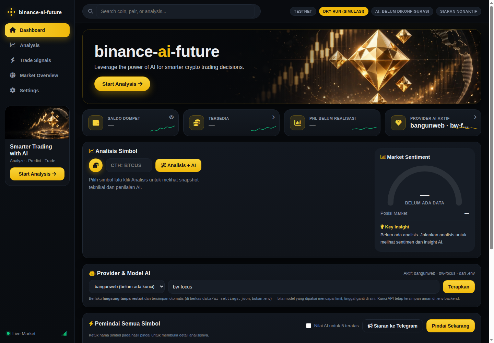
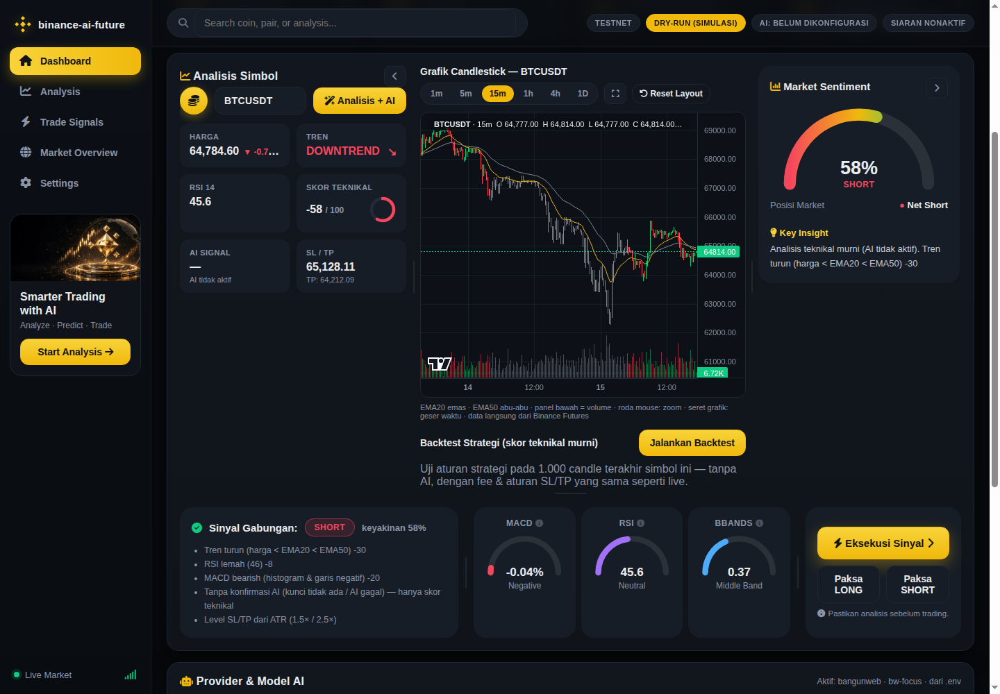
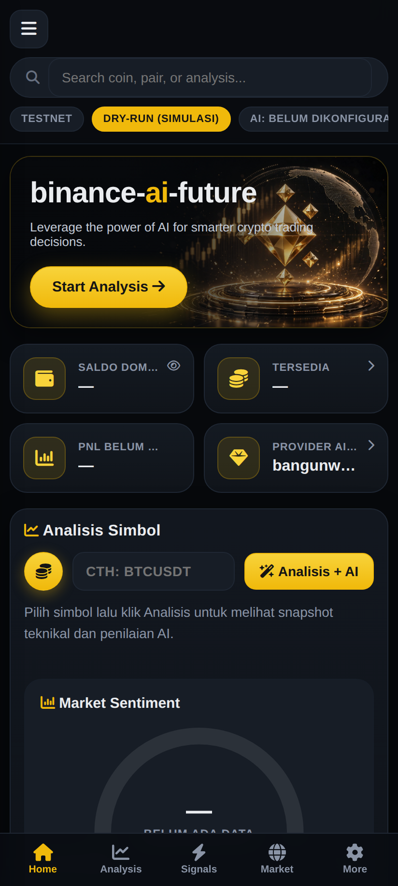
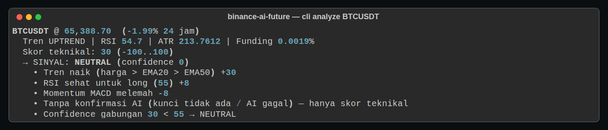
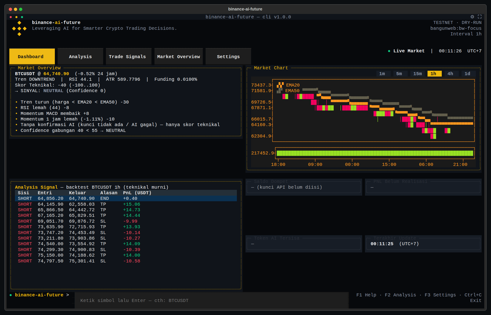
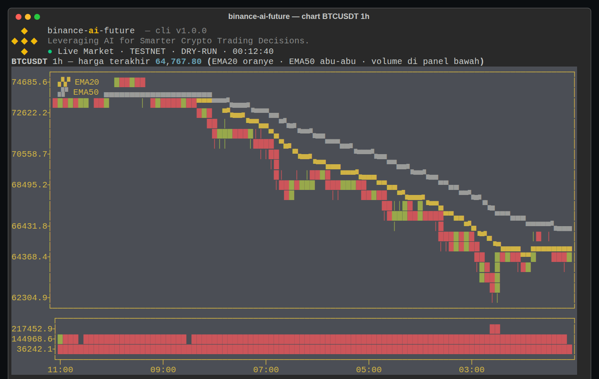
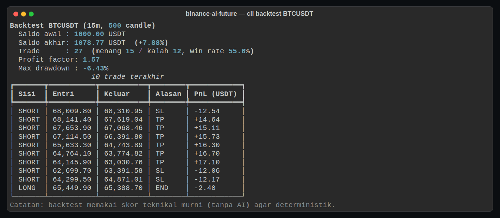
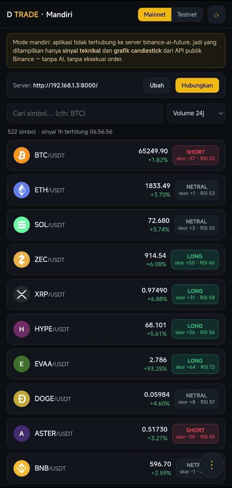
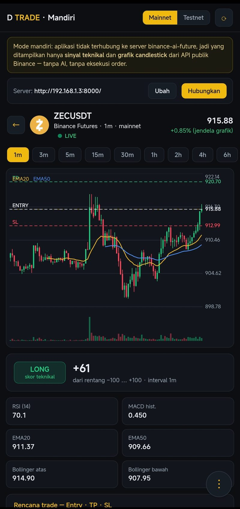
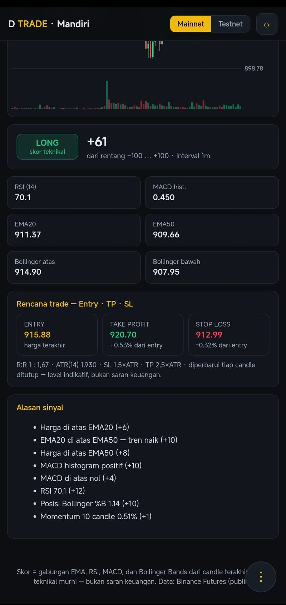

# DTRADE

Sistem trading **Binance USDⓈ-M Futures** berbantuan AI dengan standar
pengembangan profesional: memindai **semua simbol perpetual** yang tersedia di
Binance (tidak terpaku pada satu simbol), menganalisisnya dengan indikator
teknikal, meminta penilaian kedua dari **AI Router BangunWeb**, lalu
mengeksekusi order hanya setelah lolos **manajemen risiko** yang ketat.

> 🚧 **Status: Masih Dalam Tahap Pengembangan.** DTRADE adalah proyek yang
> masih aktif dikembangkan untuk keperluan belajar dan pengujian strategi
> trading. Fitur dapat berubah sewaktu-waktu, dan hasil analisisnya **belum
> teruji untuk perdagangan dengan dana riil** — bawaan pabriknya berjalan di
> **testnet + mode dry-run (simulasi)**. Jangan gunakan dengan dana riil.
>
> 🗺️ **Cakupan saat ini & roadmap.** Saat ini DTRADE hanya bisa dipakai untuk
> trading **Binance Futures**. Ke depannya akan ditambahkan market lain:
> **Spot, saham, forex, dan lainnya** — nama DTRADE dipilih agar tidak
> terikat pada satu market saja.

Tersedia dalam dua antarmuka di atas core yang sama:

- **Web UI** — dashboard responsif, nyaman dibuka dari desktop maupun browser
  ponsel (iOS/Android).
- **Terminal CLI** — perintah cepat untuk scanning, analisis, dan trading.

> ⚠️ **Peringatan risiko.** Trading futures berlevrage dapat menghilangkan
> seluruh modal Anda. Software ini adalah alat bantu analisis & eksekusi,
> bukan nasihat keuangan dan bukan jaminan profit. Mode bawaan adalah
> **dry-run** (simulasi). Gunakan mode live hanya dengan dana yang siap Anda
> rugikan, dan selalu uji dulu di testnet.

---

## Fitur Utama

- **Multi-simbol** — daftar simbol dibaca langsung dari `exchangeInfo`
  Binance saat runtime; simbol baru otomatis ikut terpindai.
- **Analisis teknikal lengkap** — EMA, RSI, MACD, Bollinger Bands, ATR, dan
  skor tren teragregasi per simbol.
- **Penilaian AI multi-provider** — snapshot pasar dinilai AI dan dikembalikan
  sebagai keputusan JSON terstruktur: sinyal, keyakinan, stop loss, take
  profit, dan alasan. Provider aktif dipilih lewat `.env` (`AI_PROVIDER`):
  **BangunWeb** (bawaan, model `bw-focus`), **OpenAI**, **Anthropic**,
  **DeepSeek**, **Grok (xAI)**, **Nous Portal**, atau gateway
  OpenAI-compatible lain (`custom`).
- **Manajemen risiko wajib** — position sizing berbasis % risiko, batas
  leverage, batas jumlah posisi, dan batas rugi harian. Tidak ada jalur
  eksekusi yang melewati modul ini.
- **Eksekusi aman** — entri market/limit disertai Stop Loss & Take Profit
  otomatis; mode dry-run mensimulasikan semuanya tanpa menyentuh akun.
- **Grafik candlestick** — Web UI menggambar candle + garis EMA20 + volume
  langsung dari data Binance, dengan pilihan interval 1m–1d.
- **Notifikasi Telegram** — hasil eksekusi (dan pesan uji) dikirim ke user id
  atau channel Telegram Anda lewat bot (@BotFather).
- **Backtest** — uji aturan strategi pada hingga 1.500 candle historis dengan
  aturan biaya & SL/TP yang sama seperti live: win rate, profit factor,
  max drawdown, dan kurva ekuitas (CLI & Web UI).
- **Mode pantau (watch)** — pemindaian berkala yang mengirim sinyal kuat ke
  Telegram; memantau saja, tidak pernah mengeksekusi order.
- **Jurnal perdagangan** — setiap eksekusi dicatat ke `logs/trades.jsonl`
  sebagai jejak audit yang bisa ditinjau kembali.
- **Data futures lengkap** — snapshot memuat funding rate bertingkat
  (kejenuhan long/short memengaruhi skor) dan open interest untuk konteks AI.
- **Cross-platform** — Python murni; berjalan di macOS, Windows, Linux, dan
  Android (Termux). Untuk iOS: jalankan server di komputer/VPS, buka Web UI
  dari Safari/Chrome ponsel.

## Tangkapan Layar

> Diambil dari data **Binance Futures Testnet** dalam mode **dry-run**
> (tanpa kunci API, tanpa dana asli) — angka yang tampil adalah keluaran
> nyata aplikasi. Khusus tangkapan Android di bawah: **mode mandiri**
> dengan data pasar publik **Mainnet** dari ponsel (tanpa server,
> tanpa akun/dana).

**Web UI — Dasbor**



**Web UI — Analisis BTCUSDT: workspace yang bisa diubah ukurannya (seret garis pemisah antar panel), grafik candlestick interaktif Lightweight Charts (EMA20 + EMA50 + volume, zoom & crosshair OHLCV), dan hasil backtest dengan kurva ekuitas**



**Web UI — Tampilan Mobile (responsif, navigasi bawah)**



**Terminal CLI — `analyze BTCUSDT`**



**Terminal CLI — `dashboard` interaktif (Textual): Market Overview, grafik candlestick + EMA, tabel backtest, metrik kunci**



**Terminal CLI — `chart BTCUSDT --interval 1h` (plotext: candlestick + EMA20/EMA50 + volume)**



**Terminal CLI — `backtest BTCUSDT` (500 candle)**



**Aplikasi Android D TRADE — Mode Mandiri (tanpa terhubung ke server DTRADE): daftar simbol berlogo koin + chip sinyal, grafik candlestick LIVE via WebSocket dengan garis ENTRY/TP/SL, dan panel rencana trade Entry/TP/SL berbasis ATR(14)**

<p>



</p>

## Arsitektur Singkat

Lihat **[STRUKTUR.MD](STRUKTUR.MD)** untuk peta folder, tanggung jawab tiap
modul, diagram aliran data, dan panduan menambah fitur.

```text
Binance REST ─► binance_client ─► indicators ─► strategy ─► risk ─► executor
                                      ▲             │
                                 ai_client (BangunWeb AI)
CLI (terminal.py) dan Web UI (web/app.py) adalah dua kulit di atas core ini.
```

## Persyaratan

- Python **3.10+**
- Akun Binance dengan **Futures USDⓈ-M aktif** + API key berizin Futures
- Kunci **AI Router BangunWeb** (bentuk `bwr_live_...`) —
  [dokumentasi resmi](https://bangunweb.com/ai/docs)

## Instalasi

### macOS / Linux

```bash
git clone https://github.com/devcoderama/DTRADE.git
cd DTRADE
python3 -m venv .venv && source .venv/bin/activate
pip install -r requirements.txt
cp .env.example .env   # lalu isi .env dengan kunci Anda
```

### Windows (PowerShell)

```powershell
git clone https://github.com/devcoderama/DTRADE.git
cd DTRADE
py -m venv .venv; .venv\Scripts\Activate.ps1
pip install -r requirements.txt
copy .env.example .env   # lalu isi .env dengan kunci Anda
```

### Android (Termux)

```bash
pkg install python git
git clone https://github.com/devcoderama/DTRADE.git
cd DTRADE
pip install -r requirements.txt
cp .env.example .env
```

### iOS

iOS tidak menjalankan Python secara native. Jalankan proyek ini di
komputer/VPS, mulai Web UI dengan `WEB_HOST=0.0.0.0`, lalu buka
`http://<ip-server>:8000` dari browser iPhone Anda dan masukkan PIN
aplikasi saat diminta (lihat "PIN Aplikasi" di bawah). Untuk akses dari
luar jaringan rumah, gunakan reverse proxy HTTPS (Caddy/nginx) atau VPN
(Tailscale) — jangan mengekspos port 8000 langsung ke internet.

## PIN Aplikasi

Web UI dilindungi **PIN aplikasi** — cara utama masuk, menggantikan token
API yang panjang:

- Saat `python run.py web` **pertama kali** berjalan, server membuat PIN
  6 digit acak dan menampilkannya **sekali** di konsol. Catat PIN itu.
- Hash PIN (PBKDF2, bukan teks asli) tersimpan di database
  `data/app.db` — **restart server tidak mengubah PIN** dan tidak perlu
  membuat PIN baru.
- Setiap membuka Web UI, masukkan PIN tersebut. Login menerbitkan sesi
  7 hari; percobaan login dibatasi ketat (5×/menit per IP) agar PIN tidak
  bisa ditebak paksa.
- Lupa PIN? Jalankan `python run.py pin` untuk membuat PIN baru (PIN lama
  dan semua sesi aktif langsung berhenti berlaku).
- Ingin PIN tertentu? Isi `WEB_PIN` (4–8 digit) di `.env`.
- `WEB_API_TOKEN` tetap didukung sebagai alternatif (header `X-API-Token`
  / login token) untuk skrip dan pemantauan.
- Di aplikasi Android D TRADE (≥ v1.29.0), mode server yang sudah pernah
  masuk dapat dibuka dengan **sidik jari** bila perangkat mendukung —
  aktif/nonaktifkan lewat dialog "Alamat Server".

## Konfigurasi `.env`

| Variabel | Keterangan |
|---|---|
| `BINANCE_API_KEY` / `BINANCE_API_SECRET` | API key Binance (lihat keamanan di bawah) |
| `BINANCE_TESTNET` | `true` = testnet dana virtual, `false` = mainnet |
| `BANGUNWEB_API_KEY` | Kunci AI Router BangunWeb (`bwr_live_...`) |
| `BANGUNWEB_MODEL` | `bw-swift` / `bw-focus` (bawaan) / `bw-pro` / `bw-apex` |
| `AI_PROVIDER` | Provider AI aktif: `bangunweb` (bawaan) / `openai` / `anthropic` / `deepseek` / `grok` / `nous` / `custom` |
| `OPENAI_API_KEY` / `OPENAI_MODEL` | Provider OpenAI (bawaan model `gpt-4o`) |
| `ANTHROPIC_API_KEY` / `ANTHROPIC_MODEL` | Provider Anthropic (bawaan `claude-sonnet-4-5`) |
| `DEEPSEEK_API_KEY` / `DEEPSEEK_MODEL` | Provider DeepSeek (bawaan `deepseek-chat`) |
| `XAI_API_KEY` / `XAI_MODEL` | Provider Grok dari xAI (bawaan `grok-4`) |
| `NOUS_API_KEY` / `NOUS_MODEL` | Provider Nous Portal (bawaan `Hermes-4-70B`) |
| `AI_CUSTOM_BASE_URL` / `AI_CUSTOM_API_KEY` / `AI_CUSTOM_MODEL` | Gateway OpenAI-compatible lain (mis. OpenRouter) |
| `TELEGRAM_BOT_TOKEN` / `TELEGRAM_CHAT_ID` | Notifikasi Telegram: token bot dari @BotFather + user id / channel id tujuan |
| `TRADING_MODE` | `dry_run` (bawaan) atau `live` |
| `RISK_PER_TRADE_PCT` | % saldo yang dirisikokan per posisi (bawaan 1.0) |
| `MAX_LEVERAGE` | Batas leverage (bawaan 5) |
| `MAX_OPEN_POSITIONS` | Batas posisi terbuka (bawaan 3) |
| `DAILY_LOSS_LIMIT_PCT` | Berhenti trading bila rugi harian mencapai % ini |
| `DEFAULT_INTERVAL` | Interval candle bawaan (bawaan `15m`) |
| `WEB_HOST` / `WEB_PORT` | Alamat & port Web UI (bawaan aman `127.0.0.1:8000`) |

### Mengganti Provider AI

Set `AI_PROVIDER` di `.env` ke salah satu provider dan isi kuncinya —
sisanya otomatis: prompt, skema JSON, dan penggabungan keputusan di
`strategy.py` identik untuk semua provider. Provider selain BangunWeb
tidak memiliki endpoint saldo token, jadi perintah `ai-account` akan
menampilkan status konfigurasi semua provider sebagai gantinya.

### Notifikasi Telegram

1. Buat bot lewat [@BotFather](https://t.me/BotFather) (`/newbot`), salin tokennya ke `TELEGRAM_BOT_TOKEN`.
2. Tujuan pribadi: ambil user id Anda dari [@userinfobot](https://t.me/userinfobot), isi ke `TELEGRAM_CHAT_ID`, lalu kirim `/start` ke bot Anda.
3. Tujuan channel: tambahkan bot sebagai **admin** channel, dan isi `TELEGRAM_CHAT_ID` dengan id channel (diawali `-100…`; bisa dilihat dari `getUpdates` atau forward pesan channel ke @userinfobot).
4. Uji dengan `python run.py cli notify-test`. Setelah itu setiap eksekusi
   `trade` (CLI maupun Web UI) otomatis mengirim ringkasannya ke Telegram.

### Keamanan API key Binance (wajib)

1. Buat key **setelah** akun Futures Anda aktif (key yang dibuat sebelumnya
   tidak bisa diberi izin Futures).
2. Aktifkan **Restrict access to trusted IPs only** dan daftarkan IP mesin
   yang menjalankan program ini — tanpa ini izin Futures tidak bisa dicentang.
3. Centang **Enable Futures** saja. **Jangan pernah** mengaktifkan
   **Enable Withdrawals** untuk key yang dipakai program apa pun.
4. Secret key hanya tampil sekali — simpan langsung ke `.env` Anda, jangan
   dibagikan ke siapa pun, jangan di-commit ke Git (`.env` sudah di-ignore).

## Keamanan Server Web

Server web dilindungi berlapis (berlaku untuk semua endpoint `/api/*`):

- **Autentikasi token** — isi `WEB_API_TOKEN` di `.env` untuk mewajibkan
  token pada semua endpoint selain `/api/health` (Fase 6-B5: token terisi
  wajib ≥ 24 karakter). Web UI akan meminta token sekali lalu mengingatnya;
  token dikirim sebagai header `X-API-Token` atau cookie sesi `HttpOnly` +
  `SameSite=Strict`. `WEB_VIEWER_TOKEN` memberi akses baca-saja. Keluar
  sesi lewat `POST /api/auth/logout`. **Tanpa token, siapa pun yang dapat
  mengakses alamat server dapat mengeksekusi trade dari akun Anda** —
  server mencetak peringatan ini setiap kali start.
- **Lapisan Fase 6** — validasi `Host` (nama domain publik tak dikenal
  ditolak; IP literal & localhost diizinkan — anti DNS-rebinding),
  pemeriksaan `Origin` untuk request POST ber-cookie (anti CSRF),
  `Content-Type: application/json` wajib untuk request berbadan, token
  WebSocket lewat `?token=` **dihapus** (gunakan cookie/header),
  `X-Forwarded-For` hanya dipercaya dari IP di `TRUSTED_PROXIES`, dan
  semua data runtime kini di bawah satu `DATA_DIR` (bawaan `data/`):
  jurnal trade `trades.jsonl`, keputusan AI `ai_decisions.jsonl`,
  `risk_state.json`, `execution_state.jsonl`.
- **CORS tanpa wildcard** — hanya origin di `CORS_ORIGINS` yang diizinkan
  (bawaan: hanya same-origin).
- **Rate limit** per IP (`RATE_LIMIT_PER_MINUTE`, bawaan 240/menit) dan
  batas ukuran request 1 MB.
- **Eksekusi terverifikasi** — order entri memakai idempotency key dan
  status isinya diverifikasi; SL/TP dipasang dengan retry + verifikasi,
  dan bila Stop Loss gagal total, posisi **ditutup darurat** secara
  otomatis. Setiap perubahan status eksekusi dicatat persisten di
  `data/execution_state.jsonl` dan diperiksa lagi saat server start.
- **Kunci risiko persisten** — batas rugi harian memakai perubahan ekuitas
  (realized + unrealized + fee) terhadap baseline awal hari yang tersimpan
  di `data/risk_state.json`, sehingga tidak hilang karena restart.

## Penggunaan

### Web UI

```bash
python run.py web
# buka http://localhost:8000  (atau http://<ip-lan>:8000 dari ponsel)
```

Dashboard menampilkan saldo & posisi, pemindai sinyal semua simbol, panel
analisis AI per simbol, dan tombol eksekusi (selalu melewati RiskManager;
dalam mode dry-run hasilnya berupa simulasi yang ditandai jelas).

### Terminal CLI

```bash
python run.py cli balance                 # saldo & ringkasan akun futures
python run.py cli symbols                 # semua simbol perpetual USDT aktif
python run.py cli scan --top 10           # pindai & peringkatkan sinyal
python run.py cli analyze BTCUSDT         # analisis teknikal + AI satu simbol
python run.py cli dashboard               # dashboard interaktif (Textual): overview, grafik, sinyal, metrik
python run.py cli chart BTCUSDT --interval 1h   # grafik candlestick terminal (plotext)
python run.py cli positions               # posisi terbuka saat ini
python run.py cli trade BTCUSDT --side LONG   # eksekusi (dry-run kecuali live)
python run.py cli close BTCUSDT           # tutup posisi satu simbol
python run.py cli ai-account              # status provider AI (+ sisa token BangunWeb bila aktif)
python run.py cli ai-model                # provider+model AI aktif saat ini
python run.py cli ai-model --provider bangunweb --model bw-pro   # ganti model (tanpa edit .env)
python run.py cli notify-test             # kirim pesan uji ke Telegram
python run.py cli backtest BTCUSDT --limit 1000   # uji strategi pada data historis
python run.py cli research BTCUSDT --days 90      # walk-forward + baseline acak → laporan di reports/
python run.py cli performance             # metrik performa dari jurnal (win rate, PF, expectancy)
python run.py cli reconcile               # satu putaran rekonsiliasi posisi ↔ proteksi ↔ jurnal
python run.py cli selfcheck               # diagnosis kesiapan: konfigurasi, kunci, DB, AI, koneksi
python run.py cli watch --top 10 --every 15       # pantau pasar, sinyal kuat → Telegram
python run.py cli broadcast               # siaran sinyal terbaik + grafik ke Telegram
python run.py cli journal                 # lihat jurnal eksekusi terakhir
```

Pengembangan: `pip install -r requirements-dev.txt` menambahkan pytest,
ruff, mypy, bandit, dan pip-audit. CI menjalankan lint, pemeriksaan tipe
(modul risk & executor), audit keamanan, dan pytest dengan gerbang
cakupan ≥70% untuk `core/risk.py` & `core/executor.py`. Riwayat lengkap
perbaikan lima fase ada di `PERBAIKAN_LOG.md`.

Perintah `trade` dalam mode `live` meminta konfirmasi pengetikan ulang simbol
sebelum order dikirim.

### Mengganti provider & model AI (tanpa edit `.env`)

Provider dan model AI **tidak terkunci di `.env`** — nilai di sana hanya
pilihan awal. Ganti kapan pun, berlaku langsung tanpa restart:

- **Web UI:** panel **🤖 Provider & Model AI** di dasbor — pilih provider,
  pilih/ketik model (ada saran + daftar model live BangunWeb), klik
  **Terapkan**.
- **CLI:** `python run.py cli ai-model --provider deepseek --model deepseek-chat`
  (`ai-model --list` menampilkan saran model per provider).

Pilihan tersimpan di `data/ai_settings.json`; server web yang sedang
berjalan memuatnya otomatis, jadi pergantian dari CLI pun langsung
berlaku di Web UI. Ini memudahkan bila model yang dipakai mencapai
limit — tinggal pindah model/provider yang kuncinya sudah ada di `.env`.

### Siaran sinyal ke Telegram (`broadcast`)

Memindai semua simbol, menyaring sinyal teknikal terkuat
(bawaan: skor ≥ 50), menganalisis kandidat dengan AI, dan hanya
mengirim yang terkonfirmasi LONG/SHORT ke channel Telegram Anda —
lengkap dengan **gambar grafik candlestick** (EMA20/50, volume, RSI,
garis SL/TP) dan caption ringkasannya.

**Otomatis (bawaan):** selama server web berjalan
(`python run.py web`), siaran berjalan sendiri di latar belakang —
putaran pertama ±30 detik setelah start, lalu tiap
`BROADCAST_INTERVAL_MINUTES` (bawaan 30 menit). Atur lewat `BROADCAST_*`
di `.env`; statusnya terlihat pada lencana "📣 Siaran Otomatis" di
dasbor. Matikan dengan `BROADCAST_ENABLED=false`.

**Manual:**

```bash
python run.py cli broadcast                       # sekali jalan, maks 3 sinyal
python run.py cli broadcast --loop 30 --cooldown 4  # berkala tanpa server web
```

Tombol **📣 Siaran ke Telegram** di panel Pemindai Web UI menjalankan
satu putaran yang sama. Syarat: `TELEGRAM_BOT_TOKEN` dan
`TELEGRAM_CHAT_ID` terisi di `.env` (bot harus menjadi admin channel
tujuan).

## Aplikasi Android — D TRADE

Proyek ini juga punya aplikasi Android resmi bernama **D TRADE**: WebView aman di atas Web UI, jadi seluruh fitur (dasbor, scan, analisis + grafik, backtest, eksekusi) bisa dipakai dari ponsel. Backend Python tetap berjalan di komputer/VPS Anda; aplikasi hanya menampilkannya.

- Unduh APK-nya dari **[Releases](https://github.com/devcoderama/DTRADE/releases)** repo ini (v1.0.0, ±650 KB, Android 7.0+).
- Setelah terpasang: buka aplikasi → menu ⋮ → **Alamat Server** → isi alamat backend Anda (mis. `http://192.168.1.10:8000` untuk satu jaringan Wi-Fi, atau domain VPS Anda).
- Sumber aplikasi ada di folder [`android/`](android/) (Kotlin, tanpa AndroidX) — cara build & penandatanganan ada di [`android/README.md`](android/README.md).

## Alur Satu Siklus Trading

1. **Scan** — klines semua simbol diambil, indikator dihitung, skor teknikal
   dibuat, kandidat terbaik dipilih.
2. **AI review** — snapshot kandidat dikirim ke BangunWeb AI; AI mengembalikan
   keputusan JSON (LONG/SHORT/NEUTRAL, confidence, SL, TP, alasan, risiko).
3. **Risk check** — RiskManager memvalidasi batas-batas dan menghitung ukuran
   posisi dari jarak stop loss.
4. **Execute** — Executor menempatkan order + SL/TP (atau mensimulasikannya
   dalam dry-run) dan mencatat semuanya ke log.

## Pengembangan

- Peta & aturan modul: [STRUKTUR.MD](STRUKTUR.MD)
- Berkontribusi: [CONTRIBUTORS.MD](CONTRIBUTORS.MD)
- Lisensi: [MIT](LICENSE)
- Uji otomatis (mock Binance & AI — tanpa jaringan, tanpa order live):
  `python -m pytest tests/ -q` — mencakup indikator, RiskManager,
  mesin status executor (termasuk skenario SL gagal → emergency close),
  metrik backtest, dan keamanan Web API.
- Docker: `docker compose up --build` (konfigurasi tetap dari `.env` Anda;
  folder `data/` dan `logs/` ter-mount sebagai volume).

### Image resmi di GitHub Packages (GHCR)

Image backend juga diterbitkan otomatis ke GitHub Container Registry —
tanpa clone repo dan tanpa build sendiri:

```bash
docker pull ghcr.io/devcoderama/dtrade:latest
docker run -d --name DTRADE \
  --env-file .env -p 127.0.0.1:8000:8000 \
  -v baf_data:/app/data -v baf_logs:/app/logs \
  ghcr.io/devcoderama/dtrade:latest
```

Tag yang tersedia: `latest` (build terbaru dari `main`), `sha-<commit>`,
dan nomor versi (mis. `1.5.0`) untuk image yang diterbitkan dari sebuah
GitHub Release. Konfigurasi tetap dari `.env` Anda — secret **tidak**
ikut di dalam image. Paketnya publik:
<https://github.com/devcoderama?tab=packages&repo_name=DTRADE>

## Penafian

Proyek ini adalah perangkat lunak sumber terbuka untuk tujuan edukasi dan
otomasi pribadi. Penulis dan kontributor tidak bertanggung jawab atas
kerugian finansial apa pun yang timbul dari penggunaannya. Lakukan riset Anda
sendiri (DYOR) dan uji di testnet sebelum memakai dana sungguhan.
